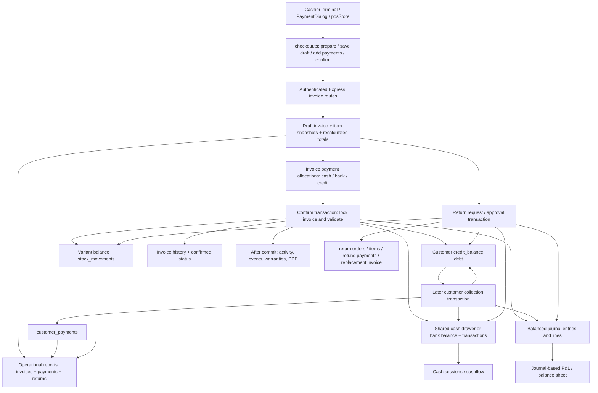

# EDARA POS — Invoice, Payment, Customer Balance & Inventory Integrity Audit

## 1. Executive Summary

**Verdict: the audited baseline is not ready for production reliance as a financially reconciled, FIFO-based POS.** Ordinary sale processing has a substantial transactional foundation, but retry handling, customer receivable semantics, reporting, costing, cash-to-journal reconciliation, and recovery require correction and isolated integration testing.

Audit date: **24 October 2026**, store timezone **Asia/Dubai**. Repository: **D:/Projects/mahali-light**. Reproducible source baseline: **0ff97898a233ef6fa5c06b050c00f3e559ecc2df**. Every source line citation below refers to that commit. Paths are relative to this repository unless absolute. A citation such as `server/services/invoiceService.js:509` means `D:/Projects/mahali-light/server/services/invoiceService.js`, baseline line 509; working-copy line numbers can differ.

**Scope and evidence limits.** This was a source, schema, frontend flow, and in-memory behavioral audit. No production database was connected, no live API was called, no financial records were read, and no actual sale, receipt, refund, backup restore, restart, migration, or inventory movement was performed. No approved isolated database was identified. Installed dependencies were used without installation. The only artifact created by this audit is this report. Existing integration suites were inspected but not run because their setup can create/drop databases or write temporary artifacts. Live database constraints, migrated schema, balances, transaction isolation, deployment configuration, and actual historical data remain **NOT TESTED**.

**Executed evidence:** 28 narrow checks of actual baseline functions or source expressions, with dependencies mocked and TypeScript compiled only in memory: **19 PASS, 9 FAIL, 0 harness errors**. B26 additionally covers 10,000 monetary inputs within its one test case. These are not 28 end-to-end tests. In particular, no mocked query result proves that the corresponding SQL runs or reconciles against PostgreSQL.

| Area | Assessment | Principal reason |
|---|---|---|
| Core confirmation/cancellation transaction design | PARTIAL | Shared database client, row locks, stock, debt, treasury and journals; real rollback/concurrency untested |
| Common invoice arithmetic | PASS for listed cases only | Backend recomputation and ordinary cent totals passed; precision/domain edge cases fail |
| Customer collection retries | FAIL | Same logical collection can post twice, F02 |
| Checkout recovery | FAIL | Lost successful confirmation response cannot be safely retried through current frontend, F03 |
| Receivables and payment reports | FAIL | Credit allocation is labeled paid/collected; aging searches zeroed invoice remainder, F04/F20 |
| FIFO | NOT IMPLEMENTED | Current-cost snapshot is used; no receipt-layer consumption, F01 |
| Refund VAT | FAIL | Splitting a 0.22 refund into two 0.11 tenders changes VAT from 0.01 to 0.02, F08 |
| Cash and financial journal reconciliation | FAIL | Opening/manual/count adjustments do not consistently post to journal, F09 |
| Returns/exchange/report agreement | FAIL | Returned value, actual refund and replacement revenue use incompatible bases, F07/F10 |
| Complete financial audit trail | PARTIAL | Best-effort activity logs and deleted collection source rows in baseline, F16 |
| Restart, backup restoration, real cashier concurrency | NOT TESTED | No approved isolated deployment used; restore success classification fails in mock, F17 |

No actual monetary loss, corrupted customer record, oversale, or production discrepancy is asserted. Financial examples are synthetic. Findings distinguish confirmed source defects from absent functionality, design gaps, and unexecuted validation.

**Concurrent work caveat.** The shared worktree changed during this audit. Other work modified customer/payment controllers, customer/invoice/return services, activity logging, customer frontend/schema/socket files, and added `038_customer_audit_integrity.sql` and `customerEvents.js`. These changes were not made by this audit and are not certified here. Early inspection indicated customer update, metrics, logging and reversal improvements were in progress. Baseline findings F02, F16, F19, F22 and others must be rechecked against the final integrated revision before deciding which remain open. This report does not claim those ongoing edits are absent or ineffective.

### Later-commit delta note

At final verification, the concurrent work had been committed as **b14d912431b92cfefa5e9e928bda5c5459ff0947** (`fix(customers): profile audit trail, financial cards and live sync`). The 28 test results and detailed finding register remain pinned to **0ff9789**. A limited read-only diff review identified the changes below; it did not rerun the newer integration suite or certify the newer database state. Only this table uses **b14d912 line numbers**.

| Baseline finding | Source change in b14d912 | Remaining qualification |
|---|---|---|
| F19: default limit overwrite / inactive credit | `server/controllers/customersController.js:36,50` separates create defaults from partial updates; `server/services/customerService.js:327` rejects inactive credit customers; deactivation locks at `customersController.js:641` | These baseline subdefects are addressed in source. Runtime behavior and financial permission separation still need verification. |
| F16: collection audit/retention | `server/services/customerService.js:153` writes collection audit through the client; `:222` archives voided payment before removal; `server/utils/activityLog.js:30` supports transactional logging; migration038 adds append-only activity-log trigger at line48 | Source retention and audit actor improve. The diff does not change reversal treasury/journal actor from original collector, and other invoice/return callers still require atomicity review. Migration deployment was not checked. |
| F22: customer card metrics | `server/controllers/customersController.js:154` uses net refund-adjusted spend, sale-time noncredit payments and revised invoice-count definitions | Customer cards are revised in source. Standalone `reportService.js` is unchanged by this commit, so broader reporting findings remain applicable by source inspection. |
| F02: collection retry | Collection service still has no request key/deduplication in the reviewed diff | The later commit adds customer-create idempotency, which is a different operation. Collection retry remains an open source issue; baseline reproducer was not rerun against b14d912. |

The later commit also adds `tests/integration/customerProfileAudit.test.js`; those tests were **not run by this audit**. FIFO, report formulas, checkout recovery, cash adjustment journaling and backup restore files were not changed by this commit. The overall readiness verdict is therefore not upgraded. At the final status check, the working tree contained this report and a separate warranty report from concurrent work; this audit did not create or edit the warranty report.

Status convention throughout: **PASS** = actually tested, within stated scope; **FAIL** = confirmed defect by execution or explicit source logic; **PARTIAL** = incomplete implementation/assurance; **NOT TESTED** = execution not performed; **NOT IMPLEMENTED** = functionality absent from the inspected financial path. Static design observations are never a runtime PASS.

## 2. Architecture & Data Flow

The repository uses Next.js/React on the frontend, Express/Node.js with `pg` on the backend, and PostgreSQL. Docker configuration selects PostgreSQL 16 and a persistent `postgres_data` volume; these deployment declarations were inspected, not exercised. Financial data access is largely service/controller SQL rather than an independent repository layer. The optional ML service is outside the critical financial transaction.

Entry points are mounted in `server/index.js:336` through `:360`: customers, invoices, returns, shared drawer, reports and finance. `server/db/postgres.js:52` provides BEGIN/COMMIT/ROLLBACK and connection release. Configured process/pool timezone is Asia/Dubai; runtime host/DB agreement was not tested.



The diagram shows connected paths, not a single transaction spanning all nodes. Draft creation, each payment allocation, confirmation, collection, and return approval are separate transactions.

| Value | Implemented source of truth | Important qualification |
|---|---|---|
| Sale price/name/SKU/quantity/cost | `invoice_items` snapshots | Cost is current variant cost when line is saved; customer identity is not similarly snapshotted |
| Invoice subtotal/discount/VAT/total | Backend calculation persisted on `invoices` | Frontend computes a preview; DB does not independently enforce all formulas |
| Invoice amount paid / balance due | Sum of `invoice_payments.amount`, including credit | Allocation remainder, not cash collected or customer AR outstanding |
| Customer outstanding debt | Stored `customers.credit_balance` | Positive means customer owes store; no complete per-invoice allocation ledger |
| Later collections | `customer_payments`, treasury, journal | Baseline void deletes source row; API does not allocate across specific invoices |
| Sellable/quarantined stock | Variant quantities + signed `stock_movements` | No FIFO cost layers; movement references usually invoice-level |
| Cash on hand | Shared drawer current balance + session transactions | Financial account 1001 is a separate journal-derived measure |
| Bank balance | Bank account current balance + bank transactions | Account row locked; physical cash excludes bank tenders |
| Financial P&L / balance sheet | `journal_entries` and `journal_lines` | Some stock/cash paths bypass corresponding journal postings |
| Operational sales/profit/VAT | Different queries over invoice/return tables | Definitions diverge from journal and from each other |
| Audit | `invoice_history`, movements, journals, `activity_logs` | Different atomicity, retention and snapshot completeness |

Key screens/flows: `web/components/cashier/CashierTerminal.tsx:395`, `CashierPaymentDialog.tsx:89`, `web/lib/pos/checkout.ts:33`, `web/store/posStore.ts:190`, invoice detail `web/app/(dashboard)/invoices/[id]/page.tsx:199`, customer detail and report screens. Critical backend services are invoice, customer, stock, cash, bank, journal, return, purchase-order, reporting, analytics, warranty, and backup services.

Important schema families: migrations 002/003 products and stock; 005 customers; 006 invoices/items/payments/history/sequences; 008 warranties; 009 returns; 010 treasury; 013 finance; 025 invoice payment idempotency; 026 payment bank/customer-invoice foreign keys; 029 custom lines; 033 singleton drawer. No baseline database trigger was identified that reconciles all operational balances to financial journals or supplies missing FIFO consumption.

## 3. Invoice-to-Customer Relationships

`invoices.customer_id` is a single nullable FK to `customers.id` (`006_invoices.sql:6`). A registered customer can have many invoices; one invoice has at most one customer ID. A non-null nonexistent ID should be rejected by PostgreSQL if the migration is applied. That enforcement was not tested on a database.

Walk-ins use NULL customer IDs. Frontend rejects a guest unpaid remainder (B18); registered remainder becomes credit (B19). Server payment creation also blocks guest credit (`invoicePaymentsController.js:98`). Cash/bank guest checkout end to end is NOT TESTED.

Draft reassignment is possible through `PUT /api/invoices/:id/items`, guarded by `invoice.create`. Confirmed invoices cannot use this draft edit path. Updating an ordinary customer's name retains its UUID and invoice association, but historical documents resolve mutable customer data: no complete invoice-level customer identity snapshot was found (F11).

**Confirmed defect:** omitted `customerId` in draft update becomes NULL (`invoicesController.js:525,533`), potentially clearing an association unintentionally (F12). A change has generic update logging but no complete old/new customer snapshot.

Customer API deletion is soft deactivation, with a baseline positive-debt check; direct physical deletion is distinct and the invoice FK uses SET NULL. Baseline credit validation locks the customer but does not reject inactive status, while later collection does (F19). Draft item selection similarly does not consistently exclude inactive products. Physical product deletion is constrained by item foreign keys, where applicable.

Customer collections are keyed by customer route parameter. The baseline public controller does not accept an invoice ID; the service's optional invoice ID and FK do not constitute a per-invoice allocation system. No public cross-customer allocation exploit was demonstrated. If allocation is introduced, same-customer consistency must be enforced explicitly (F20/F21).

## 4. Invoice Calculation Accuracy

Backend recalculates totals (`invoiceService.js:85,126,368`); it does not trust a client grand total. New invoices take the configured VAT rate from server settings (`:34`). Normal catalog price comes from the variant unless the actor has override authority. Custom lines and custom cost use additional permission checks.

Implemented formulas, with `R` meaning current cent-rounding helper:

- Line quantity = R(input quantity); unit price = R(input price).
- Line subtotal = R(quantity × unit price).
- Line discount uses explicit amount when positive, otherwise percentage; capped to line subtotal.
- Invoice subtotal = sum of rounded line subtotals.
- Stored `discount_amount` = item discounts + invoice discount.
- Taxable amount = max(0, subtotal − total discount).
- VAT = R(taxable amount × global invoice tax rate / 100).
- Grand total = R(taxable amount + VAT).
- Allocated amount = sum of invoice payments, including credit.
- Invoice balance due = max(0, total − allocated amount); recalc rejects over-allocation.

This is VAT-exclusive pricing with one invoice-wide rate. Product-level mixed VAT, per-line exemptions, inclusive-price extraction, shipping/fee components, multi-currency precision, customer deposits and a general credit-note ledger are **NOT IMPLEMENTED in the inspected checkout model**. They must not be silently represented as supported by this audit.

B01–B10, B14–B19 and B26 cover common arithmetic, discounts, half-cent VAT, permissions and preparation rules. The 10,000-value VAT comparison used integer/BigInt half-up reference arithmetic, avoiding a floating-point reference oracle. All tested ordinary VAT inputs matched.

The implementation still uses JavaScript Number plus epsilon rounding, not decimal-safe arithmetic throughout. B11/B12 show accepted quantity 0.004 becomes zero, although raw quantity × price 100 is 0.40. There are no unit-specific integral/fractional rules. B13 shows quantities/prices beyond NUMERIC(12,2) domain are accepted by validation; SQL overflow behavior was not executed. These are input-domain defects (F13), not evidence that PostgreSQL stores an overflowing number.

Full-discount math returns zero and paid (B05), but cashier dialog blocks total <= 0 (F25). Excessive invoice discount clamps taxable amount to zero; whether discount should instead be bounded to subtotal needs an explicit business rule.

The displayed/printed invoice uses stored totals rather than the reporting double-discount expression. Source review did not find that same double-counting in `InvoiceTotalsBlock`. Actual browser rendering, printed PDFs and database round trips are NOT TESTED. Operational reports nevertheless disagree with these invoice values (F05–F08).

## 5. Payment Integrity

`POST /api/invoices/:id/payments` (`invoicePaymentsController.js:57`) locks the invoice, validates a required idempotency key, rejects key reuse with different payload, accepts an exact replay, restricts new allocations to drafts, and rejects amounts over remaining allocation. Migration `025_invoice_payment_idempotency.sql:2` adds a unique partial index on invoice/key. Amount validation is finite, positive, cent precision. Cash, bank and credit are the implemented methods.

Multiple allocations can belong to one invoice. Their original timestamps, notes, actor and relevant bank account are stored. There is no general payment-to-many-invoices allocation table or invoice-payment edit/delete endpoint. Draft allocations do not themselves transfer treasury or decrement stock; confirmation performs settlement. Abandoned drafts can therefore contain allocation rows that do not represent completed receipts.

Confirmation requires complete allocation, including credit. A 105 invoice with 30 cash and 75 credit is marked paid with zero invoice balance, while customer debt rises by 75. A draft with only 30 allocated remains partial; the server cannot confirm it until the rest is allocated. Later collections go through the customer-payment flow, not confirmed invoice payment creation.

The proper invariant for the present model is:

```text
invoice allocation remainder = invoice total − sum(valid draft/confirmed allocation rows)
customer AR = credit sales − later collections − credit reductions + reversals
actual cash/bank collection ≠ invoice amount_paid when credit allocations exist
```

Refunds are separate records; original invoice payments are retained. This is acceptable only if every downstream report understands gross allocations versus net settlements.

**Limits:** these are manual POS tender declarations. There is no integrated processor authorization/capture/settlement state machine in this path, so a declared bank tender is not independent proof of funds. Cash tender change is capped in frontend preparation (B17); the API rejects direct over-allocation. Customer collection cannot exceed debt (B21), but its retries are not idempotent (B20/F02). Provider failures, duplicate HTTP payment requests against PostgreSQL, rollback and cancellation races are NOT TESTED.

The frontend's invoice detail payment action targets confirmed unpaid invoices, whereas the server only accepts draft payments; cashier resume refuses drafts already containing payments (F14).

## 6. Customer Balance Reconciliation

The balance model is **hybrid**: operational transaction records plus a stored debt aggregate and general-ledger AR. `credit_balance` means outstanding debt, not customer-owned store credit. Confirmation increases it for credit allocations; collection decreases it; credit refund decreases it subject to available debt; voiding collection increases it; cancellation subtracts the original credit allocation when the aggregate permits.

`customerService.js:50` locks the customer before collection, checks activity and available debt, inserts a payment, updates debt, posts treasury and journal on the same client. Credit limit enforcement also locks the row (`:280`); zero limit means unlimited. These mechanisms are promising source-level controls, not tested concurrent behavior.

Suggested reconciliation equation, **not executed against actual data**:

```text
Customer debt =
  approved opening debt
+ confirmed credit allocations
− cancelled credit allocations
− valid later collections
+ collection reversals
− approved credit reductions
+ approved debit adjustments
```

The baseline lacks a complete append-only customer subledger and allocation schedule implementing every term. Opening debt, advances/deposits and customer-owned store-credit liabilities are not first-class supported flows. Aggregate debt must also reconcile to journal account 1003, with explicit handling for any manual journal adjustments.

Cancellation determines whether credit was collected using the customer's total balance, not the original invoice's allocated collections (`invoiceService.js:935`). This is not proof that aggregate debt is arithmetically wrong; it means invoice-level settled/unsettled status is unknowable and cancellation decisions depend on other invoices (F20).

| Customer metric | Baseline basis | Assessment |
|---|---|---|
| Total Spent | Gross confirmed/noncancelled invoice totals | Does not consistently net returns; F22 |
| Credit Balance / Outstanding | Stored positive debt aggregate | Can match ledger only with complete, deduplicated posting |
| Last Purchase | Max invoice creation date over qualifying invoices | Creation date can differ from actual confirmation date |
| Last Payment | Customer collection table | Misses cash/bank payments at sale; F22 |
| Invoice Count | Qualifying invoice rows | Replacement/zero-value invoices may count as additional orders |
| Average Order Value | Gross totals / qualifying invoice count | Exchange/return basis needs definition |
| Customer Since | Customer creation timestamp | Persistent field; lifecycle display not tested |
| Status | Mutable active flag | Baseline credit/collection enforcement asymmetric; F19 |

No balances or ledger variances were computed from production data. Reassignment after confirmation is blocked through the ordinary draft path; draft reassignment should not move already-posted debt because confirmation has not occurred. That behavior remains NOT TESTED end to end.

## 7. Inventory Deduction

`invoiceService.js:509` locks the draft, validates items and allocations, and calls `stockService.applyStockMovement` on the same transaction client. The stock service locks the variant (`:123`), computes before/after, rejects negative sellable stock (`:173`), updates balance and inserts a movement (`:196,216`). Credit sales use the same completed-sale path. Later customer collections do not call stock movement.

A retry against the same confirmed invoice is rejected by status before normal stock posting. This reduces double deduction for the same ID; it does not prevent a new duplicate invoice after an ambiguous response (F03). No runtime exactly-once claim is made.

Repeated variant lines are prechecked individually, but central sequential stock movements recheck under the lock. It would be incorrect to infer an oversale merely from the nonaggregated precheck. Real last-unit and repeated-line races still need tests.

Confirmed edit requests lock invoice/request, move stock by quantity delta, require unchanged final total, and reverse/repost journals. Stale draft edits have no version conflict control (F23). Invoice API has no hard-delete endpoint; privileged SQL deletion could cascade item/payment/history rows (F21).

Stock conservation needs separate dimensions:

```text
Sellable = opening + purchase receipts + good returns + releases + positive adjustments
           − confirmed sales − quarantines − negative adjustments − other valid outflows
Quarantined = opening quarantine + quarantines − releases − disposals
```

No actual conservation query was run. There is no inspected FIFO layer conservation to compare. Custom noncatalog items intentionally skip stock. Drafts do not reserve stock. Movement records retain actor/source/before/after but generally lack direct sale-line and serial-unit identity. Required serial presence is checked, not stock-unit ownership or one serial per physical unit (F18). Fractional quantity acceptance is not unit-aware (F13). A setting advertises negative stock, but the movement engine always rejects it (F24).

## 8. FIFO & COGS

**NOT IMPLEMENTED.** The required FIFO claim is contradicted by the financial path.

`purchaseOrderService.js:188` records receipt/cost history; `:205` overwrites the variant's current cost. `invoiceService.js:164,293` copies that current cost into a draft item. Confirmation multiplies the snapshot by quantity (`:652`). No receipt-layer remaining quantity, chronological layer locking, consumption rows, or returned-layer linkage was found in baseline migrations and the inspected receipt/sale/return paths. Cost history is not FIFO consumption.

Synthetic source-derived illustration, not a database test:

| Event | Required FIFO result | Implemented current-cost path |
|---|---|---|
| Receive 1 at 10, then 1 at 20 | Two layers: 10 and 20 | Current variant cost becomes 20 |
| Sell 1 on newly saved invoice | COGS 10; remaining inventory 20 | Snapshot COGS 20 |
| Compare purchase value 30 less COGS | Inventory book value 20 | Journal residual 10, while live quantity × current cost reports 20 |

Existing invoice line snapshots protect that line's historical cost from ordinary product cost edits. They can also be stale if a draft predates a receipt. Analytics return-cost reversal uses current variant cost, so historical profit can change after subsequent cost changes (F07). Standard return journal reversals use original item snapshots, which is better historical behavior but still not FIFO.

Layer-spanning sales, partial consumption, original-layer restoration, concurrent layer depletion, backdating and negative-stock costing are NOT TESTED and cannot pass until layers exist. Required fix F01 is a costing subsystem, not a report-only formula change.

## 9. Shared Cash Drawer

The model intentionally uses one shared drawer. `033_cash_drawer_singleton.sql:21` enforces singleton intent; `cashService.js:47,202` locks the row, associates transactions with a session, records actor and before/after, and updates the balance. Bank payments use the bank service and do not add physical cash. Supported tender naming is cash/bank/credit; an independent card processor flow is not present.

Posting defaults to **auto-opening a closed drawer** with its current balance (`cashService.js:178,209`). This is an implemented policy, not inherently a defect. It needs explicit business acceptance and session-race tests.

For a session before counted-close adjustment:

```text
Expected cash = opening cash + valid cash in − valid cash out
Discrepancy = counted closing cash − expected cash
```

Close records expected amount and discrepancy, can require a note/force according to tolerance, and sets drawer balance to counted cash. Opening and closing transaction rows are excluded from normal movement totals. A close transaction can have amount zero while before/after differs; that difference is a count adjustment, not an ordinary sale receipt.

**F09:** opening balance selection, manual adjustment and counted discrepancies change physical-cash state without corresponding financial journal treatment. Consequently drawer balance and account 1001 need not reconcile. Opening 100 with no journal entry produces drawer 100 and no corresponding journal cash increase in that path; any legitimate prior-book balance must be explicitly carried forward, not assumed.

Invoice cancellation reverses recorded cash/bank postings and keeps the original bank account selection. Customer collection duplicates can inflate cash and lower debt twice (F02). Cash shortages can block cash-out; some bank reversals allow overdraft. Explicit inactive bank account IDs are not rejected by the resolver, unlike automatic default selection (F26).

Real two-cashier posting, session close races, bank settlements, receipt-to-session sums and drawer counting are NOT TESTED.

## 10. Returns & Refunds

The return request stores original invoice-item identity, committed requested quantities and prorated values. Source checks lock the invoice/items, include pending/approved committed returns when limiting quantities, reject duplicate items, and recheck on approval (`returnService.js:54,413,729`). B08 verifies one cent-conservation example; B09 verifies refund-plan sum rejection. Database race behavior is NOT TESTED.

Good returns restore sellable stock. Damaged returns use return-in followed by quarantine in one transaction, with no net increase in sellable stock (`:904,918`). Disposal is a distinct stock action. Standard return COGS reversal uses original item snapshot when inventory is restored (`:989`). Custom lines are explicitly excluded from the ordinary return builder (`:469`).

Refund payment rows, debt changes, treasury, journal, return completion and original invoice return flag are in the approval transaction. Original sale totals/payment rows remain; reports must subtract proper return measures. Refund plan accepts cash/bank/credit and enforces the required sum, but does not require original tender method. Alternate tender refund may be intentional; define approval and account policy rather than assuming original-method enforcement exists.

Credit refund reduces customer debt up to available aggregate debt. It does not create a customer-owned store-credit balance. General credit notes and advance/refundable-deposit accounting are NOT IMPLEMENTED in this flow.

Defects:

- VAT is independently extracted per refund tender, causing split rounding differences (F08).
- Exchange creates a zero-value or difference-only replacement invoice, hardcodes VAT zero, and assumes cash for an additional amount (F10).
- Dashboard/VAT reports can deduct full returned value where the journal reverses only the refund amount (F07).
- Source-line serial/warranty handling does not establish unit-level return traceability (F18).

Cancellation locks the invoice, rejects incompatible return state, reverses stock, original treasury and journals, updates status, and retains history. Its credit check uses aggregate customer debt (F20). Separate collection void deletes the original payment row in the baseline (F16). Duplicate/simultaneous refund, full mixed-tender return, changed tax rate, repeated partial returns, and reversal after later collections remain NOT TESTED on a database.

## 11. Concurrent Cashier Safety

| Operation | Source safeguard | Residual concern / execution status |
|---|---|---|
| Same invoice confirmed twice | Invoice FOR UPDATE and draft-state guard | Second call rejects; no successful-result replay; DB race NOT TESTED |
| Last available unit sold twice | Variant FOR UPDATE and nonnegative guard | Correct serialization intent; actual race NOT TESTED |
| Same invoice payment key twice | Invoice lock + unique invoice/key index | Payload replay validation; HTTP/DB test NOT TESTED |
| Same collection retried | Customer row lock | Serializes two debits but does not deduplicate; B20 FAIL |
| Concurrent collections | Customer balance checked under lock | Prevents aggregate overcollection intent, not same-request duplicate |
| Concurrent returns | Invoice/request/item locks and cumulative quantity checks | Multi-request race NOT TESTED |
| Same draft edited twice | Row lock | Last writer wins with no expected version, F23 |
| Shared drawer transactions | Singleton + row lock | Session/close races and real totals NOT TESTED |
| Multiple product carts in opposite orders | Several variant locks | Lock-order/deadlock behavior untested; no general retry policy found |
| Number generation | Atomic sequence upsert + unique invoice number | Contention test NOT TESTED |
| Lost HTTP response | Backend may have committed | Frontend recovery fails B25; new duplicate sale remains possible |
| Process/container failure | PostgreSQL transaction intent | Crash recovery and durable commit response behavior NOT TESTED |

The connection helper does not explicitly select stronger transaction isolation or implement bounded deadlock/serialization retries. Do not equate row locks with complete concurrency proof, and do not retry non-idempotent financial commands blindly. Store-wide access by permission holders is the apparent model; no owner-isolation assumption is imposed.

## 12. Invoice Numbering & Persistence

`docNumbers.js:18,26` atomically upserts `document_sequences` by document type/year/scope, increments and returns the number. `invoices.invoice_number` is unique; UUID primary key is separate. Human numbering includes server year and sanitized PC scope; replacement invoices use their own scope. Preview does not reserve a number. Standard create schema does not accept an arbitrary final invoice number.

Sequence updates using the invoice transaction roll back with failure; numbering gaps can still arise from retained cancelled/abandoned documents and other lifecycle choices. Gapless fiscal numbering is not an established requirement or verified property. Refunds preserve original invoice number and add return/replacement references.

Persistence is designed through PostgreSQL and the Docker volume. Invoice/transaction timestamps use TIMESTAMPTZ with store timezone configuration. Midnight/year transition, restart, timezone conversion, volume durability and restored sequence continuity are NOT TESTED.

Backup uses database-wide custom-format `pg_dump`, so schema, records and sequence data are intended to be covered. This is coverage by source design, not a restore certification. `dbBackup.js:98` accepts pg_restore exit code 1 as success (B28/F17), and its restore command is not a single-transaction validation procedure. No actual archive was restored or inspected. API offers cancellation, not financial invoice hard deletion; schema cascades still require privileged-data retention controls (F21).

## 13. Financial Reporting Accuracy

Reports currently use incompatible meanings of paid, collected, revenue, refunds and COGS.

| Measure / source | Confirmed issue or limit | Finding |
|---|---|---|
| Sales summary discounts, `reportService.js:64` | Adds invoice discount to stored discount total that already includes it | F05 |
| Sales summary total collected, `:88,101` | Sums credit allocations as collection; later collections absent from this total | F04 |
| Customer aging, `:961,972` | Searches positive invoice balance_due, although confirmed credit invoices have zero allocation remainder | F04/F20 |
| Product sales/profit, `:185` | Line totals omit invoice-level discount allocation and net returns; margin sort references missing SQL alias | F06 |
| Period sales, `:140` | Invoice-only gross series does not provide net return reconciliation | F06 |
| Dashboard collection rate, `analyticsService.js:995` | Zero invoice allocation remainder yields 100% for credit sales | F04 |
| Dashboard return revenue, `:908,917` | Uses returned value rather than actual refund/replacement accounting basis | F07 |
| Dashboard return COGS, `:925` | Current cost and incomplete stock-action treatment differ from journal reversal | F07 |
| VAT report, `financialReportService.js:376,397` | Return total_value basis differs from actual refund journal for exchanges | F07 |
| Inventory valuation, `reportService.js:391,502` | Current sellable quantity × current cost, not FIFO; quarantine not represented as a separate valued layer | F01 |
| P&L / balance sheet, `financialReportService.js:136,202` | Journal-based; missing operational postings cause disagreement | F09/F15 |
| Cashflow, `:272,336` | Treasury flows combined with journal opening balance can disagree | F09 |
| Customer summary, `customersController.js:100` | Gross spend and collection-only last-payment semantics | F22 |

Synthetic examples:

1. Item discounts 20 plus invoice discount 10 produce stored total discount 30, but affected report expression yields **40** (B16).
2. A credit-only invoice 105 produces **totalCollected 105** instead of **0 actual collection** (B24).
3. Equal-value exchange of a 100 sale with no refund creates a zero-total replacement. Dashboard subtracts returned value 100 and can show net revenue 0; refund-based sale summary and journal retain the original 100 revenue. This is a source-derived contradiction, not a database result.
4. A cost change after sale can alter analytics return COGS although original invoice COGS remains snapshotted.
5. A 0.22 taxable refund's VAT differs by tender split (B27).

Cancelled invoices are excluded in ordinary invoice reporting and journal reversal is implemented. Later customer collections do not inherently constitute a new sale in the journal. Those sound intentions do not repair incorrect operational collection labels or incomplete return netting. Daily/monthly buckets, average order value, zero-value replacement invoice counts, and gross versus net VAT need one documented basis and reconciliation fixtures. No actual report-to-ledger totals were compared.

## 14. Security & Audit Logging

Authentication middleware checks JWT/session and loads user permissions. Invoice routes require authentication and module permissions. Server-side discount denial was actually tested (B15). Other security observations are static; no live unauthorized requests were sent, including GETs whose authentication can update session activity.

| Action | Baseline backend gate |
|---|---|
| Create/edit draft/confirm/add invoice allocation | `invoice.create` |
| Cancel invoice | `invoice.cancel` |
| Request/approve confirmed edit | `invoice.edit_request` / `invoice.edit_approve` |
| View/download/print | `invoice.view` / `invoice.download` / `invoice.print` |
| Change price or discount | Service/controller checks `invoice.override_price` |
| Custom line / custom cost | Separate custom-item and cost visibility authority |
| Collect/void customer payment | `customer.collect_payment` |
| Create/approve return | `return.request` / `return.approve` |
| Edit customer/limit/status | `customer.edit` |
| Adjust/open/close/transfer shared cash | `cash.adjust` |
| Operational report | Per-report controller permission |
| Financial statements/journal | Specific `finance.view_*` / period-close authority |

A role that is allowed to create invoices can edit any draft exposed by the store-wide model; no draft-owner/version restriction was found. This is a policy decision, not demonstrated unauthenticated IDOR. Credit limit/status updates deserve separate authority if ordinary cashiers have customer.edit (F19). Forced cash close uses the same cash-adjust authority; no independent second approver was found in that route.

`invoice_history` is written within core transactions, but old/new snapshots are not complete for every edit or reassignment. `activityLog.js:3` writes via pool independently and catches errors. Depending on caller timing, an event can survive a later rollback or fail after a financial commit. Stock/treasury/journal records retain substantial actor/reference evidence, but payment void attributes reversal posting to the original collector and deletes the source payment in baseline (F16). No baseline append-only protection was found for every financial audit table. Ongoing migration/helper changes are outside this baseline assessment.

## 15. Transaction Atomicity

| Boundary | Included in transaction by source | Outside / limitation |
|---|---|---|
| Create/update draft | Invoice, item replacement, recalculation, history | Each HTTP operation separate; create has no retry key |
| Add invoice allocation | Invoice lock, key check, payment insert, recalculation, history | Does not settle treasury or stock |
| Confirm invoice | Invoice/items checks, stock, customer debt, treasury, sale journal, status/history | Activity/event/PDF/warranty side effects occur later |
| Cancel invoice | Invoice lock, stock reversal, aggregate debt reversal, treasury reversal, journal reversal, status/history | Warranty void/activity outside core transaction |
| Customer collection | Customer lock, payment, debt, treasury, journal | Activity after commit; no idempotency |
| Collection void | Payment/customer locks, source deletion, debt/treasury/journal reversal | Incomplete attribution/retention |
| Approve return/exchange | Locks, stock disposition, order/items/refunds, debt, treasury/journal, replacement invoice, status | Divergent accounting semantics still possible atomically |
| Manual cash adjustment | Drawer/transaction consistent within cash service | No corresponding journal posting |
| Warranty replacement | Physical stock/new zero-value invoice in warranty flow | Missing financial journal integration |

B22/B23 verify only that the actual helper invokes BEGIN/ROLLBACK or BEGIN/COMMIT and release under mocked callbacks. They do not prove SQL atomicity, statement validity, or PostgreSQL recovery.

A receipt generation failure should not undo a committed sale; postcommit PDF generation is appropriate. Warranty issuance is deferred and caught after sale commit (`invoiceService.js:806`), which creates a different traceability obligation: failed issuance needs durable retry/reconciliation. Core financial commitment should be recoverable independently of successful printing/event delivery.

The frontend awaits confirmation before clearing/completing the cart (`CashierTerminal.tsx:395,430`), so no unconditional precommit success was found. Its error message wrongly treats a timeout as proof that the sale did not complete (F03).

## 16. Error Handling

Validation and domain errors are explicitly raised for missing customer/product, over-allocation, stock shortage, illegal state and refund-plan mismatch. Database failures inside the shared transaction should reach rollback; end-to-end failure injection was not performed.

| Failure stage | Source-derived behavior | Assurance |
|---|---|---|
| Invalid product/price during draft save | Throws; draft transaction should roll back | NOT TESTED with DB |
| Insufficient stock during confirm | Throws under locked stock update; enclosing transaction should roll back prior movements | NOT TESTED with DB |
| Debt/credit-limit/treasury/journal failure | Propagates through confirmation transaction | NOT TESTED with DB |
| Invoice allocation save succeeds, confirm fails | Draft allocations remain; stock/settlement should not commit | UI cannot reliably resume payment-bearing draft, F14 |
| Confirm commits, HTTP response lost | Backend sale may exist; retry starts by rewriting draft | B25 FAIL, F03 |
| Activity-log failure | Best effort/caught; financial action can still succeed | PARTIAL audit integrity, F16 |
| PDF/printing failure | Sale remains committed | Appropriate boundary; actual retry NOT TESTED |
| Warranty generation failure | Caught after sale commit | Missing durable traceability recovery assurance, F18 |
| Deadlock / lock timeout | Transaction error; no general idempotent retry layer identified | NOT TESTED |
| Restore process exit 1 | Reported success | B28 FAIL, F17 |

A timeout must display **outcome unknown, checking sale status** until the server resolves the stable operation ID. It must not instruct an unconditional new sale. Expected validation errors should be distinguished from capacity/precision/database failures, including accepted extreme inputs (F13).

## 17. Edge-Case Test Matrix

### Executed isolated checks

All preconditions are synthetic. Functions were loaded from the pinned commit into Node VM contexts; database/treasury/journal/network dependencies were mocked. Source extraction was used for nonexported helpers. No database statements were executed. Severity describes the risk if the asserted property fails, not a new duplicate finding.

| ID | Scenario / preconditions | Expected | Actual | Result | Evidence | Severity |
|---|---|---|---|---|---|---|
| B01 | Cash: 3 × 100, VAT 5%, tender 315 | Total/paid 315, due 0, paid | Same | PASS | computeTotals | High |
| B02 | Draft 100 + VAT 5%, allocated 30 | Total105, paid30, due75, partial | Same | PASS | computeTotals | High |
| B03 | Credit allocation 105 on total105 | Allocated105, remainder0, paid; no cash assertion | Same | PASS | computeTotals | High |
| B04 | Subtotal200, item discount20, invoice discount10, VAT5% | Discount30, taxable170, VAT8.50, total178.50 | Same | PASS | computeTotals | High |
| B05 | Full discount | Total0 and paid | Same | PASS | computeTotals only; UI excluded | Medium |
| B06 | Taxable2.90 at5% | VAT0.15 | 0.15 | PASS | computeTotals | Medium |
| B07 | Amount10 plus percent20 on100 | Explicit amount takes precedence:10 | 10 | PASS | computeLineFigures | Medium |
| B08 | Total1 spread over3 equal lines | Refundable .33,.34,.33; sum1 | Same | PASS | refundableLineValues | High |
| B09 | Refund due2, plan1 | Reject plan mismatch | BIZ_REFUND_PLAN_MISMATCH | PASS | actual refund validator | High |
| B10 | Item quantity0 or−1 | Reject both | Both rejected | PASS | actual item schema | High |
| B11 | Item quantity0.004 | Reject unsupported precision | Accepted | FAIL | schema; F13 | High |
| B12 | Accepted quantity0.004 × price100 | Preserve0.40 or reject before math | Line amount0 | FAIL | computeLineFigures; F13 | High |
| B13 | Quantity and price10^15 | Reject beyond DB supported domain | Accepted | FAIL | schema; F13 | Medium |
| B14 | Negative unit price | Reject | Rejected | PASS | schema | High |
| B15 | Discount without override permission | Deny | AUTH_NO_PERMISSION | PASS | actual authority helper | High |
| B16 | B04 stored discount30, invoice discount10 | Report discount30 | Report expression40 | FAIL | source expression, not SQL run; F05 | Medium |
| B17 | Tender200 against105 | Allocate105, treat remainder as change | 105 | PASS | prepareCheckout | High |
| B18 | Walk-in, unpaid remainder5 | Reject | Rejected | PASS | prepareCheckout | High |
| B19 | Registered customer, cash30 against105 | Credit75 | 75 | PASS | prepareCheckout | High |
| B20 | Debt200, identical collection50 twice | One payment; debt150; treasury50; journal1 | Two; debt100; treasury100; journal2 | FAIL | collectPayment + synthetic query adapter; F02 | High |
| B21 | Debt100, collection101 | Reject | BIZ_PAYMENT_EXCEEDS_BALANCE | PASS | collectPayment + adapter | High |
| B22 | Transaction callback fails | BEGIN, ROLLBACK, release | Same | PASS | actual wrapper/mocked client | High |
| B23 | Transaction callback succeeds | BEGIN, COMMIT, release | Same | PASS | actual wrapper/mocked client | High |
| B24 | Credit-only105 with synthetic SQL aggregate | Actual collection0 | totalCollected105 | FAIL | actual salesSummary/mocked SQL result; F04 | High |
| B25 | Confirm commits then response times out; retry same draft | Recover completed sale | BIZ_INVOICE_LOCKED | FAIL | actual submitSale + fake API; F03 | High |
| B26 | 10,000 cent values .01–100 at5% | Match exact half-up VAT | 0 mismatches | PASS | BigInt reference vs computeTotals | Medium |
| B27 | Taxable refund.22 at5%; split.11+.11 | Same VAT as unsplit:.01 | Split VAT.02 | FAIL | actual refund journal function, mocked posting; F08 | Medium |
| B28 | Mock pg_restore close event exit1 | success false | success true | FAIL | actual restore wrapper, no spawned process; F17 | High |

### Required database / browser / recovery matrix

Every row below is **NOT TESTED**. Preconditions specify the isolated fixture to create later; actual behavior is **not executed** for every row. Source references are candidate control locations, not successful test evidence. The matrix complements the executed checks rather than upgrading them to integration passes.

| ID | Scenario and preconditions | Expected behavior / assertion | Result; actual | Evidence target | Severity |
|---|---|---|---|---|---|
| E01 | Walk-in cash sale; stocked variant | NULL customer; correct invoice, stock, cash and journal | NOT TESTED; not executed | invoice confirm + cash | High |
| E02 | Registered cash sale | Correct customer UUID, history, no debt increase | NOT TESTED; not executed | invoices/customers | High |
| E03 | Registered partial cash + credit | Full allocation; debt only remainder; one stock deduction | NOT TESTED; not executed | confirm credit branch | High |
| E04 | Credit-only sale within limit | AR increases; cash unchanged; inventory decrements | NOT TESTED; not executed | invoice/journal | High |
| E05 | Cash/bank/credit split; active bank account | Exact method/account postings; totals reconcile | NOT TESTED; not executed | invoicePayments/treasury | High |
| E06 | Advance/deposit attempt; zero debt | Explicit unsupported rejection or liability model | NOT TESTED; not executed | customer collection | High |
| E07 | Overpayment via direct API | Reject without partial insert or balance mutation | NOT TESTED; not executed | payment controller | High |
| E08 | Later collection after credit sale | Debt reduced once; no revenue/stock increase | NOT TESTED; not executed | customerService | High |
| E09 | Duplicate invoice allocation key, same/different payload | Same replay; conflicting payload rejected | NOT TESTED; not executed | unique index + controller | High |
| E10 | Duplicate collection HTTP request | One durable financial effect | NOT TESTED; not executed | F02 | High |
| E11 | Good partial return:1 of3 | Restore1; prorated refund/VAT/COGS once | NOT TESTED; not executed | returnService | High |
| E12 | Full split-tender return | Original refundable amount/tax conserved | NOT TESTED; not executed | F08 | High |
| E13 | Damaged return | No sellable-stock increase; quarantine and journal agree | NOT TESTED; not executed | return stock_action | High |
| E14 | Disposed return | Correct no-stock/cost treatment and reporting | NOT TESTED; not executed | return/analytics | High |
| E15 | Repeat partial returns with rounding | Sum never exceeds original quantity or cents | NOT TESTED; not executed | return approval | High |
| E16 | Full cancellation cash/bank sale | Stock/treasury/journal reversed; history retained | NOT TESTED; not executed | cancelInvoice | High |
| E17 | Cancel credit sale after collection plus another invoice | Defined invoice allocation or explicit safe alternative | NOT TESTED; not executed | F20 | High |
| E18 | Out-of-stock sale | No invoice confirmation or financial partial effects | NOT TESTED; not executed | stockService | High |
| E19 | Fractional sale of weighed vs piece unit | Supported precision exact; piece fraction rejected | NOT TESTED; not executed | F13 | High |
| E20 | Repeated identical variant lines near stock limit | Correct sum; whole transaction rolls back if short | NOT TESTED; not executed | sequential stock engine | High |
| E21 | Multiple products, one invalid or short | Atomic all-or-nothing effects | NOT TESTED; not executed | withTransaction | High |
| E22 | Mixed VAT/exempt/inclusive requests | Explicit rejection until modeled; no silent wrong tax | NOT TESTED; not executed | invoice calculation | High |
| E23 | Discounts and cent boundaries through SQL/PDF | Same approved totals everywhere | NOT TESTED; not executed | frontend/server/PDF | High |
| E24 | Two cashiers sell final unit | One success; other rejection; stock0 | NOT TESTED; not executed | variant lock | High |
| E25 | Concurrent opposite-order multi-product carts | No drift; bounded conflict handling | NOT TESTED; not executed | locks/deadlocks | High |
| E26 | Concurrent approvals returning final refundable unit | At most one succeeds | NOT TESTED; not executed | return locks | High |
| E27 | Concurrent partial allocations to same invoice | Total never exceeds invoice; unique replay | NOT TESTED; not executed | invoice lock | High |
| E28 | Two stale draft editors | Version conflict instead of silent overwrite | NOT TESTED; not executed | F23 | Medium |
| E29 | Lost confirm response, then refresh/retry | Recover original sale, never create duplicate | NOT TESTED; not executed | F03 | High |
| E30 | Inject DB error after each stock/debt/treasury/journal step | Full rollback and safe recovery | NOT TESTED; not executed | transaction boundary | High |
| E31 | Kill backend / restart Docker around commit | Exactly one committed operation recoverable | NOT TESTED; not executed | durability/idempotency | High |
| E32 | Nonexistent and inactive customer | FK/domain rejection per policy; no partial state | NOT TESTED; not executed | F19 + FK | High |
| E33 | Invalid/deleted/inactive product | Reject before sale; historical item retained | NOT TESTED; not executed | replaceItems/FKs | High |
| E34 | Unauthorized create/edit/cancel/refund/discount/report | 401/403 and no data mutation | NOT TESTED; not executed | auth/routes/service checks | High |
| E35 | Intentional inconsistent synthetic records | Reconciliation detects each discrepancy | NOT TESTED; not executed | section19 queries/design | High |
| E36 | Two receipt costs, layered sale, partial return | FIFO layer order/value conserved | NOT TESTED; not executed | F01 missing subsystem | High |
| E37 | Backdated receipt/sale; closed period | Explicit period/cost policy; no silent recost | NOT TESTED; not executed | stock/journal | High |
| E38 | Shared drawer posting versus close/open | Session/cash/actor totals remain consistent | NOT TESTED; not executed | cashService | High |
| E39 | Manual cash-in/out, count discrepancy | Drawer equals financial cash after approved adjustments | NOT TESTED; not executed | F09 | High |
| E40 | Equal/higher/lower exchange via each tender | Revenue/VAT/COGS/refund/account reconcile | NOT TESTED; not executed | F07/F10 | High |
| E41 | Same serial on two cashiers; quantity>1; serial edit | Unique physical unit ownership enforced | NOT TESTED; not executed | F18 | High |
| E42 | Number generation under contention/year rollover | Unique stable IDs/numbers; defined scope | NOT TESTED; not executed | docNumbers | High |
| E43 | Restore backup into fresh isolated DB | Zero-error restore, records/sequences/FKs/journals reconcile | NOT TESTED; not executed | F17 | High |
| E44 | Zero-price/full-discount cashier sale | Explicit authorized completion policy, no UI dead end | NOT TESTED; not executed | F25 | Medium |
| E45 | Cashier changes customer details without limit field | Existing credit limit unchanged | NOT TESTED; not executed | F19 baseline | High |
| E46 | Later product cost change then rerun historical reports | Historical COGS/returns unchanged | NOT TESTED; not executed | F07 | High |
| E47 | Payment-bearing draft recovery after failed confirm | Cashier can safely resume/reverse allocations | NOT TESTED; not executed | F14 | High |
| E48 | Activity failure/transaction rollback and payment void | Atomic event, correct actor, retained source | NOT TESTED; not executed | F16 | High |
| E49 | Inactive explicit bank account | Rejected or separately authorized historical reversal | NOT TESTED; not executed | F26 | Medium |
| E50 | Midnight/date range, refunds in later month | Consistent store date, accrual/collection/return periods | NOT TESTED; not executed | reporting/timezone | Medium |

## 18. Critical Defects

The following register contains production blockers and lesser defects. Severity expresses plausible financial/operational impact; priority expresses fix order. **P0** = resolve before relying on financial close/FIFO production claims; **P1** = resolve before broad rollout; **P2** = scheduled improvement with explicit accepted policy. No confirmed unauthenticated exploit or observed production loss is alleged.

### F01 — Required FIFO costing is absent

**Severity: High. Priority: P0. Status: NOT IMPLEMENTED.**  
**Location:** `server/services/purchaseOrderService.js:188,205`; `server/services/invoiceService.js:164,293,652`; `server/services/reportService.js:391`.  
**Root cause/evidence:** Receipts overwrite current variant cost; invoices snapshot that scalar; sale COGS multiplies snapshot by quantity. No layer consumption records support FIFO. The section8 two-receipt example demonstrates the formula difference; no database FIFO scenario was run.  
**Financial impact:** Wrong COGS, margin and inventory valuation under changing costs; financial inventory may disagree with operational valuation.  
**Recommended fix:** Introduce receipt layers, locked consumption allocations, immutable sale cost allocation, original-layer return handling and explicit backdate/negative-stock policy. Migrate only with reviewed opening valuation and reconciliation.

### F02 — Customer collection retry can post twice

**Severity: High. Priority: P0. Status: FAIL, executed with mocks.**  
**Location:** `server/controllers/customerPaymentsController.js:11,58`; `server/services/customerService.js:24,50,81,100,110,137`.  
**Root cause/evidence:** No stable request key or uniqueness check in collection path. Customer lock serializes requests but treats the retry as a new payment. B20: debt200, collection50 twice gives two rows, debt100, treasury100 and two journals instead of one payment/debt150/treasury50.  
**Financial impact:** False debt reduction and cash/bank inflation when a response is lost or a user retries. Actual production incidence unknown.  
**Recommended fix:** Require customer-scoped collection idempotency key, payload fingerprint and stored authoritative response; enforce uniqueness and post debt/treasury/journal once in the same transaction. Check in-progress work before duplicating its fix.

### F03 — Checkout cannot recover an ambiguous successful confirmation

**Severity: High. Priority: P0. Status: FAIL, executed with mocks.**  
**Location:** `web/lib/pos/checkout.ts:99,117,128,138,156`; `server/controllers/invoicesController.js:411`; `server/services/invoiceService.js:511,521`.  
**Root cause/evidence:** Retry saves/rewrites draft before checking confirmed status. B25 simulates a committed confirmation with lost response; retry gets BIZ_INVOICE_LOCKED. Timeout message states sale was not completed. Draft creation has no end-to-end operation key.  
**Financial impact:** Cashier may create a second invoice, duplicate stock/receivable effects, or leave an already-paid customer in an unresolved flow. Same-ID confirm status guard prevents ordinary repeated confirmation but does not solve recovery.  
**Recommended fix:** Persist checkout operation UUID before first write, deduplicate create/confirm, return existing committed result on valid replay, and query operation outcome after timeouts.

### F04 — Credit allocations are reported as collected money; aging is ineffective

**Severity: High. Priority: P0. Status: FAIL, source and mocked execution.**  
**Location:** `server/services/invoiceService.js:85`; `server/services/reportService.js:88,101,961,972`; `server/services/analyticsService.js:995`.  
**Root cause/evidence:** Invoice payment sums include credit. Reports sum these as totalCollected and use zero invoice allocation remainder for collection rate/aging. B24 reports105 collection for credit-only105. Confirmed credit invoices normally have balance_due0, so aging's positive-balance predicate finds no date and labels debt current.  
**Financial impact:** Overstated collection, understated delinquency and misleading liquidity/credit decisions.  
**Recommended fix:** Separate tender allocation, actual settlement and open AR; aggregate real cash/bank receipts by receipt date; age remaining invoice receivables from a real allocation ledger.

### F05 — Invoice discount is counted twice in reports

**Severity: Medium. Priority: P1. Status: FAIL, executed source expression.**  
**Location:** `server/services/invoiceService.js:85`; `server/services/reportService.js:64,289,528,1145`.  
**Root cause/evidence:** Stored discount_amount already contains item plus invoice discounts; report expressions add invoice_discount again. B16 yields40 for actual discount30. SQL itself was not executed.  
**Financial impact:** Discount totals and discount-rate analytics are overstated; reconciliation to receipts fails.  
**Recommended fix:** Define one canonical total discount and separate item/invoice components without overlapping sums. Repair every affected aggregation and add a shared reconciliation fixture.

### F06 — Product and period reports do not represent consistent net sales

**Severity: Medium. Priority: P1. Status: FAIL, source-confirmed.**  
**Location:** `server/services/reportService.js:140,185,193,201,222`.  
**Root cause/evidence:** Product aggregation sums line_total without allocating invoice-level discount or net returns. Period series is invoice-only. Margin sort uses SQL ORDER BY margin although margin is only calculated later in JavaScript.  
**Financial impact:** Product margins/revenue disagree with invoices and returns; margin sorting can fail as a query. No live SQL error was induced.  
**Recommended fix:** Store or deterministically allocate invoice discounts/tax to lines, net linked returns consistently, declare gross versus net time series, and sort by an actual selected expression or the completed result.

### F07 — Return/exchange reporting disagrees with journals and historical costs

**Severity: High. Priority: P0. Status: FAIL, source-confirmed.**  
**Location:** `server/services/analyticsService.js:908,917,925,976`; `server/services/financialReportService.js:376,397`; `server/services/reportService.js:102`; `server/services/returnService.js:989,1291`.  
**Root cause/evidence:** Some reports subtract total returned value, others actual refund; replacement invoice is zero/difference-only. Analytics reverses COGS using current variant cost rather than original returned cost and disposition. Section13 equal-exchange example produces incompatible revenue bases.  
**Financial impact:** Net sales/VAT/profit change by report or later cost edit; stock disposition may be valued incorrectly.  
**Recommended fix:** Adopt a single exchange accounting model and event-level original revenue/tax/cost allocations; report from those posted events. Treat refund, trade-in, physical return and disposal as separate measures.

### F08 — Splitting a refund changes VAT reversal

**Severity: Medium. Priority: P1. Status: FAIL, executed with mocks.**  
**Location:** `server/services/journalService.js:737,761`; `server/services/returnService.js:1034,1070`.  
**Root cause/evidence:** VAT extraction rounds independently for each tender. B27: refund0.22 at5% produces VAT0.01 in one tender but0.02 for two tenders0.11.  
**Financial impact:** Refund tax and revenue journals can disagree with original/cumulative tax entitlements by cents; repeated splits accumulate.  
**Recommended fix:** Compute exact total return VAT from original invoice allocation once; distribute cents among tenders with a deterministic residual rule. Preserve cumulative caps over repeated partial returns.

### F09 — Drawer adjustments bypass financial cash journal

**Severity: High. Priority: P0. Status: FAIL, source-confirmed.**  
**Location:** `server/services/cashService.js:337,364,414,450,474,505,568`; `server/controllers/cashDrawerController.js:97`; `server/services/financialReportService.js:202,336`.  
**Root cause/evidence:** Open/manual-adjust/count-close paths change physical-cash balances without equivalent journal posting. Closing records discrepancy and sets counted balance; financial statements use journal account1001.  
**Financial impact:** Cash-on-hand, balance sheet and cashflow opening values can disagree despite valid individual drawer transactions.  
**Recommended fix:** Carry opening cash from reconciled prior book balance; post real funding/withdrawals and approved shortages/overages to appropriate accounts atomically. Do not book every new session opening as fresh revenue or duplicate funding.

### F10 — Exchange difference hardcodes zero VAT and cash

**Severity: High. Priority: P1. Status: FAIL, source-confirmed.**  
**Location:** `server/services/returnService.js:1291,1295,1303,1402,1415,1427`.  
**Root cause/evidence:** Replacement invoice total is price difference only, tax_rate/tax_amount are zero, and positive difference automatically creates cash payment. No actual selected tender is carried into that branch.  
**Financial impact:** Taxable additional sale may lack the expected configured tax; bank-paid differences can inflate drawer cash. Future refundable entitlement of replacement goods is constrained by its difference-only invoice value.  
**Recommended fix:** Model return credit and full replacement sale consistently, or document an equivalent allocation model preserving original entitlements; collect actual tender/account and calculate configured tax. This is a software consistency finding, not a tax-law opinion.

### F11 — Customer identity is not preserved as an invoice snapshot

**Severity: Medium. Priority: P1. Status: PARTIAL.**  
**Location:** `server/db/migrations/006_invoices.sql:6,34`; `server/controllers/customersController.js:412`.  
**Root cause/evidence:** Invoice stores customer UUID but no complete customer name/contact/tax identity snapshot analogous to item snapshots. Customer fields remain mutable; physical deletion uses SET NULL.  
**Financial impact:** Regenerated historical documents and identity evidence can change after customer edits or privileged deletion.  
**Recommended fix:** Capture required customer identity at confirmation, retain association separately, and distinguish historical document data from current contact details. Verify privacy/retention policy separately without rewriting old invoices.

### F12 — Draft update can silently remove its customer

**Severity: High. Priority: P1. Status: FAIL, source-confirmed.**  
**Location:** `server/controllers/invoicesController.js:491,525,533,563`.  
**Root cause/evidence:** Optional customerId is written as body.customerId ?? null, so omission behaves as explicit clearing. Generic logging does not provide full reassignment old/new context.  
**Financial impact:** Misassociated history, interrupted credit checkout, or unintended anonymous invoice after an otherwise unrelated draft edit. Confirmed balance transfer is not demonstrated.  
**Recommended fix:** Preserve existing association when absent; allow explicit NULL only through intentional reassignment rules; record old/new customer, actor, reason and expected invoice version.

### F13 — Quantity precision, units and numeric bounds are not validated consistently

**Severity: High. Priority: P1. Status: FAIL, executed validation/math.**  
**Location:** `server/controllers/invoicesController.js:365`; `server/services/invoiceService.js:126,253`; `web/store/posStore.ts:190`; `server/db/migrations/006_invoices.sql:43`.  
**Root cause/evidence:** Positive quantities are accepted without scale/unit/domain checks; backend rounds quantity as money before multiplication while frontend uses raw quantity. B11/B12 turn0.004×100 into0; B13 accepts10^15 inputs beyond DB precision.  
**Financial impact:** Wrong preview/line quantities, unusable zero-quantity lines and avoidable DB errors; no overflowing SQL write was executed.  
**Recommended fix:** Separate quantity precision from currency precision, enforce unit-specific scale/integer rules and finite bounds at API/service/DB boundaries. Use decimal or scaled-integer arithmetic with a documented rounding policy.

### F14 — Payment-bearing draft recovery has no consistent UI path

**Severity: High. Priority: P1. Status: FAIL, source-confirmed.**  
**Location:** `web/components/cashier/CashierTerminal.tsx:494`; `web/app/(dashboard)/invoices/[id]/page.tsx:199`; `server/controllers/invoicePaymentsController.js:84`.  
**Root cause/evidence:** Cashier resume refuses drafts with payments and directs user to invoices; detail-page add-payment gate requires confirmed invoice with positive balance, but API only permits draft allocations and confirmation requires full allocation.  
**Financial impact:** Interrupted checkout becomes operationally stranded; users may duplicate the sale or require manual intervention. UI execution was not performed.  
**Recommended fix:** Provide a resumable draft-payment workflow with existing allocations, idempotent addition, safe allocation reversal and confirmation. Keep invoice AR collections a separate explicit action.

### F15 — Warranty replacement stock is not integrated with the financial journal

**Severity: High. Priority: P0. Status: FAIL, source-confirmed.**  
**Location:** `server/services/warrantyService.js:529,568,674`; `server/services/financialReportService.js:136,202`.  
**Root cause/evidence:** Replacement path creates a confirmed zero-value invoice and physical stock out; no journal service posting for replacement COGS/inventory was found in that service. Its stock movement is not a normal sale-confirmation journal path.  
**Financial impact:** Physical inventory decreases without corresponding financial inventory/expense posting; invoice-cost analytics and general-ledger P&L can diverge.  
**Recommended fix:** Post approved warranty expense/recovery and inventory cost atomically with the physical replacement, with explicit supplier reimbursement treatment. Include this adjacent path in invoice/stock reconciliation.

### F16 — Financial audit evidence is incomplete and collection source rows are deleted

**Severity: High. Priority: P1. Status: PARTIAL, with source-confirmed defects.**  
**Location:** `server/utils/activityLog.js:3,29`; `server/services/customerService.js:170,206,233,253`; `server/controllers/customerPaymentsController.js:137,151`; `server/services/invoiceService.js:1356`.  
**Root cause/evidence:** Generic activity logging is best effort on a separate pool connection; snapshots often lack old values. Collection void deletes original row and attributes treasury/journal reversal to original collector, because void service receives no current actor.  
**Financial impact:** Incomplete forensic reconstruction, wrong reversal attribution, and audit entries that are not guaranteed atomic with financial changes.  
**Recommended fix:** Append explicit reversal events retaining source row, pass actual actor/reason, write required financial audit records through the transaction client, and protect append-only evidence. Reassess pending customer audit migration/helper work before implementing.

### F17 — Restore exit code 1 is treated as success

**Severity: High. Priority: P0. Status: FAIL, executed with mock process.**  
**Location:** `server/backup/strategies/dbBackup.js:73,98`; `server/backup/backupService.js:582`.  
**Root cause/evidence:** Restore wrapper returns success for code0 or1. B28 injects only a close event code1 and receives success true; no actual process or restore was run. Restore also lacks a full validated atomic recovery procedure.  
**Financial impact:** A partial/errored restoration can be presented as successful, undermining invoice/payment/sequence recovery.  
**Recommended fix:** Treat any nonzero exit as failure, retain bounded diagnostic detail, restore to isolated staging, and validate schema, balances, journals, numbering and source references before cutover.

### F18 — Serial tracking does not enforce physical unit sale ownership

**Severity: High. Priority: P1. Status: PARTIAL / NOT IMPLEMENTED for unit ledger.**  
**Location:** `server/services/invoiceService.js:271,447,806,1185`; `server/db/migrations/008_warranties.sql`; `server/services/returnService.js:1357`.  
**Root cause/evidence:** One serial string per line, presence check only, no authoritative stock-unit lifecycle. Warranty uniqueness occurs after sale commit and is not a transactional stock sale constraint. Confirmed edits/replacement lines do not consistently revalidate serials; exchange replacement writes NULL serial.  
**Financial impact:** Duplicate serial sales, quantity/serial ambiguity, and weak return eligibility evidence are possible even when aggregate stock is correct. No concurrent serial exploit was executed.  
**Recommended fix:** Create unit identifiers linked to receipt, stock state, sale line and return; enforce availability/ownership in the sale transaction; separately retry warranty issuance durably.

### F19 — Baseline customer controls can remove credit protection or strand inactive debt

**Severity: High. Priority: P1. Status: FAIL for default overwrite; PARTIAL for policy enforcement.**  
**Location:** `server/controllers/customersController.js:35,39,412,464`; `server/services/customerService.js:64,280,291`; `server/routes/customers.js:21`.  
**Root cause/evidence:** Update schema inherits creditLimit default0, so omission can reset limit to unlimited. customer.edit controls financial limit/status as well as contacts. Credit-sale limit check lacks active-state rejection, while collection rejects inactive customers. Baseline deactivation check/update is not one locked transaction.  
**Financial impact:** Credit exposure can increase unintentionally; inactive customers may acquire debt that ordinary collection refuses.  
**Recommended fix:** True partial update semantics, explicit limit-change permission/audit, locked active-state rules and a permitted settlement path for existing inactive debt. Current in-progress customer work must be retested against this baseline finding.

### F20 — Aggregate debt cannot establish per-invoice settlement or aging

**Severity: High. Priority: P1. Status: PARTIAL.**  
**Location:** `server/controllers/customerPaymentsController.js:58`; `server/services/customerService.js:81`; `server/services/invoiceService.js:935,946`; `server/services/reportService.js:961`.  
**Root cause/evidence:** Later payments reduce only customer aggregate debt; no invoice-allocation schedule exists. Cancellation tests aggregate balance against original credit amount. The same customer with multiple invoices can pass/fail cancellation depending on unrelated debt.  
**Financial impact:** Invoice statements, aging, refund entitlement and credit-note reconciliation are ambiguous. This is not proof of a wrong aggregate arithmetic result: legitimate customer-level offsetting can conserve net debt.  
**Recommended fix:** Define settlement/offset policy and persist invoice-level allocations, including reversals and credit reductions. Derive both invoice AR and customer balance from the same immutable subledger.

### F21 — Database constraints do not independently enforce all financial invariants

**Severity: Medium. Priority: P1. Status: PARTIAL.**  
**Location:** `server/db/migrations/005_customers.sql`; `006_invoices.sql:16,36,56,81`; `013_finance.sql:58`; `server/services/stockService.js:135,216`.  
**Root cause/evidence:** Financial child invoice IDs can be nullable; statuses/amount domains are not comprehensively constrained; stock source IDs are polymorphic and lack sale-line FK; product/variant pair consistency is mainly application responsibility. Journals have line-side checks but no inspected deferred cross-line balance constraint. Privileged invoice deletion cascades history/payment/item rows.  
**Financial impact:** Alternate write paths, manual maintenance or migration errors can create unreconciled records despite ordinary service checks. No production inconsistency was measured.  
**Recommended fix:** Add validated domain/reference/retention constraints and transaction-level posting integrity; inventory existing data before enforcing. Preserve legitimate NULL custom-item fields and optional walk-in customer.

### F22 — Baseline customer summary metrics mix gross sales with incomplete payment history

**Severity: Medium. Priority: P1. Status: FAIL, source-confirmed.**  
**Location:** `server/controllers/customersController.js:100,110,122`; `server/services/reportService.js:914`.  
**Root cause/evidence:** Spend/count/average use qualifying invoice totals without consistent return adjustment; lastPayment reads only later customer collections and omits sale-time cash/bank payments.  
**Financial impact:** Customer statements/loyalty/credit decisions use misleading spend or activity.  
**Recommended fix:** Define gross sales, net spend, actual receipts, invoice count and sale date separately; include appropriate sale-time tenders in last-payment activity. Recheck current uncommitted metrics improvements.

### F23 — Concurrent draft edits silently overwrite one another

**Severity: Medium. Priority: P1. Status: PARTIAL.**  
**Location:** `server/controllers/invoicesController.js:506,525`; `server/services/invoiceService.js:147`.  
**Root cause/evidence:** Row lock serializes full item replacement but no expected version/updated-at condition rejects a stale client payload.  
**Financial impact:** One cashier can unknowingly replace another's items, customer or discounts before finalization. Actual browser race NOT TESTED.  
**Recommended fix:** Add optimistic invoice version checks and a clear refresh/merge workflow; optionally restrict draft ownership according to store policy.

### F24 — Negative-stock setting conflicts with central stock validation

**Severity: Low. Priority: P2. Status: FAIL, source-confirmed.**  
**Location:** `server/services/invoiceService.js:440,464`; `server/services/stockService.js:173`.  
**Root cause/evidence:** Confirmation precheck reads the setting, but central movement always rejects below-zero stock.  
**Financial impact:** Operational checkout failure when configured behavior suggests it should work; no evidence of unauthorized negative stock from this discrepancy.  
**Recommended fix:** Remove/disable unsupported setting or implement a fully authorized negative-stock costing policy consistently. Prefer explicit prohibition until valuation policy exists.

### F25 — Cashier cannot complete a valid zero-total sale

**Severity: Medium. Priority: P2. Status: FAIL, source-confirmed; calculation tested.**  
**Location:** `web/components/cashier/CashierPaymentDialog.tsx:89`; `server/services/invoiceService.js:85`.  
**Root cause/evidence:** Dialog blocks total <=0, while backend math supports a fully discounted zero-total paid invoice (B05).  
**Financial impact:** Authorized complimentary/full-discount workflows are blocked and may lead to workarounds outside normal records.  
**Recommended fix:** Either explicitly prohibit such sales in both layers or add a permissioned zero-tender completion path that still posts stock/cost/audit.

### F26 — Explicit inactive bank account can receive new postings

**Severity: Medium. Priority: P1. Status: FAIL, source-confirmed.**  
**Location:** `server/services/bankService.js:76,79,89,96`.  
**Root cause/evidence:** Explicit ID branch locks and returns account without checking is_active; automatic account selection filters active accounts.  
**Financial impact:** New sales/collections may be posted to a retired account, complicating reconciliation. Historical reversal may legitimately need that account, so a blanket rejection would be wrong.  
**Recommended fix:** Distinguish new posting from historical reversal; reject inactive account for new tenders unless specifically authorized, preserve original account for reversals.

## 19. Database Integrity Risks

No database integrity scan was executed. Migration definitions do not prove deployed constraints match the repository, and no table counts or real customer values are included.

| Invariant | Existing safeguard | Gap / needed reconciliation |
|---|---|---|
| Invoice customer exists | Nullable FK | Physical delete nulls association; no immutable customer snapshot |
| Item/payment belongs to invoice | FK | Nullable child keys; cascade retention risk |
| Human invoice number unique | UNIQUE + sequence upsert | Restore/sequence continuity untested |
| Same invoice payment replay once | Unique invoice/key | Baseline collection/create/confirm end-to-end keys missing |
| Product and variant consistent | Individual FKs / service lookup | No universal composite consistency enforcement in stock writer |
| Invoice total agrees with lines | Service recalculation | No DB-wide invariant across alternate writers |
| Customer debt agrees with AR | Locked service updates | No complete allocation ledger/reconciliation result |
| Stock agrees with movements | Central locked mutation | Polymorphic references and no per-unit/layer evidence |
| Drawer agrees with transactions | Locked balance updates | Count adjustment semantics; journal divergence |
| Journal balanced | Service checks; debit-or-credit line check | No independently verified database cross-line protection |
| Refund <= original entitlement | Locked service quantity/value guards | Tax split allocation and exchange entitlement gaps |
| Financial record retention | API cancellation | Baseline collection DELETE; invoice cascades |
| Financial event audit atomic | Invoice history in core transaction | Best-effort generic activity outside same client |

Reconciliation should compare **four independent views**: source financial events, customer/tender subledgers, physical stock layers, and general ledger. A balanced journal alone can record the wrong sale twice. A correct drawer running balance alone can disagree with account1001. A zero invoice balance alone can coexist with unpaid customer AR.

Historical-data repair must distinguish evidence-backed corrections from unknown starting balances. Do not overwrite stored debt or stock merely to match an incomplete sum. Preserve differences and their investigation records.

## 20. Missing Tests

The missing assurance is predominantly integration and recovery, not another layer of tests mirroring arithmetic helpers. Required suites:

1. Transaction failure injection at each invoice/collection/refund mutation, asserting every relevant table and journal before/after.
2. Real PostgreSQL concurrency with separate clients for last-unit sales, invoice allocation replay, collection replay, two refunds and session closing.
3. Browser checkout recovery after each possible lost response, including draft created, payment allocated and confirmation committed.
4. Golden journal/subledger/report reconciliation for cash, bank, credit, later collection, mixed partial return, exchange and warranty replacement.
5. FIFO receipt/sale/return allocation fixtures once implemented, including partial layers, backdating and original-cost restoration.
6. Restore into a fresh isolated database, sequence continuity, financial reconciliation and crash/restart recovery.
7. Role/permission matrix through actual HTTP endpoints, including direct body manipulation and inactive entity handling.
8. Property-based monetary tests over quantities, discounts, VAT, cumulative partial returns and supported numeric limits, with exact arithmetic oracle.
9. Migration/constraint tests over deliberately inconsistent synthetic records, never production data.
10. Snapshot/document tests proving invoice identity/totals remain stable after customer/product edits.

The existing test setup was not executed because it may select a local database and create/drop test databases or temporary files. No isolated target was approved. B01–B28 were instead executed without network/DB/file-writing dependencies. Node runtime was **v24.15.0**. Installed TypeScript was used for in-memory transpilation; no package versions or dependencies were changed.

The reproducibility appendix in this section includes the actual isolated harnesses. They read the pinned baseline through git and require existing dependencies. Their mocked results establish only the assertions stated in section17. The main harness uses the unchanged shared error-code module and installed validation/transpilation packages; it does not import application database connections. Each unexpected dependency is blocked. The second harness replaces process spawning with a synthetic event source.

<details>
<summary>Reproduce B01–B26 (read-only, in-memory harness)</summary>

Run from `D:/Projects/mahali-light` by piping this JavaScript to `node -` (PowerShell single-quoted here-string). No script file is required. This uses existing dependencies and git; it does not connect to PostgreSQL.

```javascript

const fs=require('fs'),vm=require('vm'),assert=require('assert/strict');
const ts=require('./web/node_modules/typescript');
const {execFileSync}=require('child_process');
const baseline='0ff97898a233ef6fa5c06b050c00f3e559ecc2df';
const source=file=>execFileSync('git',['show',baseline+':'+file],{encoding:'utf8'});
const errors=require('./shared/errorCodes');
const denied=()=>{throw new Error('Unexpected side effect blocked by audit harness');};
function load(file,deps={},expose='',typescript=false){
 let src=source(file);
 if(expose)src+='\nmodule.exports.__audit={'+expose+'};';
 if(typescript)src=ts.transpileModule(src,{compilerOptions:{module:ts.ModuleKind.CommonJS,target:ts.ScriptTarget.ES2020}}).outputText;
 const module={exports:{}};
 vm.runInNewContext(src,{module,exports:module.exports,require:(key)=>{
 if(Object.hasOwn(deps,key))return deps[key];throw new Error('Unapproved dependency '+key+' in '+file);
 },console,Date,Map,Set,Number,Math,JSON,process:{env:{}},setImmediate:denied,setTimeout:denied},{filename:file});
 return module.exports;
}
const base={
 '../db/postgres':{query:denied,withTransaction:denied},
 '../utils/dates':{todayStoreDate:()=> '2026-10-24',storeDate:x=>String(x).slice(0,10)},
 '../../shared/errorCodes':errors,
 '../utils/docNumbers':{nextDocumentNumber:denied},
 './stockService':{applyStockMovement:denied},
 './customerService':{assertWithinCreditLimit:denied},
 '../utils/activityLog':{logActivity:async()=>{}},
 '../config/storeSettings':{},
 './warrantyService':{},
 './cashService':{},'./bankService':{},'./journalService':{},
 './notificationService':{},'./pricingRestrictionService':{},
};
const inv=load('server/services/invoiceService.js',base);
const ret=load('server/services/returnService.js',base);
const schema=load('server/controllers/invoicesController.js',{
 zod:require('zod'),'../db/postgres':base['../db/postgres'],
 '../utils/response':{},'../../shared/errorCodes':errors,
 '../utils/activityLog':base['../utils/activityLog'],'../services/invoiceService':inv
},'itemSchema,createSchema,updateItemsSchema,assertDiscountAuthority').__audit;
const results=[];
async function test(id,name,expected,fn){
 try{let actual=await fn();results.push({id,name,expected,actual,result:JSON.stringify(actual)===JSON.stringify(expected)?'PASS':'FAIL'});}
 catch(e){results.push({id,name,result:'HARNESS_ERROR',error:e.message});}
}
const line=(q,p,d=0)=>({quantity:q,unit_price:p,discount_amount:d});
(async()=>{
 await test('B01','Cash sale: 3 x 100 plus 5% VAT', [315,315,0,'paid'],()=>{const x=inv.computeTotals({items:[line(3,100)],payments:[{amount:315}],taxRate:5});return[x.total,x.amountPaid,x.balanceDue,x.paymentStatus];});
 await test('B02','Draft partial payment 30 of 105',[105,30,75,'partial'],()=>{const x=inv.computeTotals({items:[line(1,100)],payments:[{amount:30}],taxRate:5});return[x.total,x.amountPaid,x.balanceDue,x.paymentStatus];});
 await test('B03','Credit is an allocation, not cash',[105,0,'paid'],()=>{const x=inv.computeTotals({items:[line(1,100)],payments:[{amount:105,method:'credit'}],taxRate:5});return[x.amountPaid,x.balanceDue,x.paymentStatus];});
 await test('B04','Stacked discounts: 200 less 20 less 10, 5% VAT',[30,170,8.5,178.5],()=>{const x=inv.computeTotals({items:[line(2,100,20)],payments:[],invoiceDiscount:10,taxRate:5});return[x.discountAmount,x.taxableAmount,x.taxAmount,x.total];});
 await test('B05','100% discounted invoice',[0,'paid'],()=>{const x=inv.computeTotals({items:[line(1,100,100)],payments:[],taxRate:5});return[x.total,x.paymentStatus];});
 await test('B06','Half-cent VAT boundary',0.15,()=>inv.computeTotals({items:[line(1,2.90)],payments:[],taxRate:5}).taxAmount);
 await test('B07','Explicit line amount takes precedence over percent',10,()=>inv.computeLineFigures({...line(1,100,10),discount_percent:20}).discountAmount);
 await test('B08','Three-line refundable cents conserved',[0.33,0.34,0.33],()=>Array.from(ret.refundableLineValues({total:1},[{id:'a',line_total:1},{id:'b',line_total:1},{id:'c',line_total:1}]).values()));
 await test('B09','Incomplete refund plan rejected','BIZ_REFUND_PLAN_MISMATCH',()=>{try{ret.validateRefundPlan([{method:'cash',amount:1}],2,{required:true});return'accepted';}catch(e){return e.code;}});
 const v='11111111-1111-4111-8111-111111111111';
 await test('B10','Zero and negative quantities rejected',[false,false],()=>[0,-1].map(quantity=>schema.itemSchema.safeParse({variantId:v,quantity}).success));
 await test('B11','Sub-cent quantity must not be silently accepted and rounded to zero',false,()=>schema.itemSchema.safeParse({variantId:v,quantity:0.004}).success);
 await test('B12','Actual line math for accepted 0.004 quantity retains nonzero quantity value',0.4,()=>inv.computeLineFigures(line(0.004,100)).lineTotal);
 await test('B13','Numeric input bounded to database precision',false,()=>schema.itemSchema.safeParse({variantId:v,quantity:1e15,unitPrice:1e15}).success);
 await test('B14','Negative price rejected',false,()=>schema.itemSchema.safeParse({variantId:v,quantity:1,unitPrice:-1}).success);
 await test('B15','Discount without override permission denied','AUTH_NO_PERMISSION',()=>{try{schema.assertDiscountAuthority({user:{permissions:['invoice.create']}},{invoiceDiscount:1});return'allowed';}catch(e){return e.code;}});
 await test('B16','Actual report discount expression agrees with stored total discount',30,()=>{const x=inv.computeTotals({items:[line(2,100,20)],payments:[],invoiceDiscount:10});return x.discountAmount+x.invoiceDiscount;});
 const front=load('web/lib/pos/checkout.ts',{'@/services/invoiceService':{}},'',true);
 await test('B17','Cash tender 200 for 105 retains only 105',105,()=>front.prepareCheckout({totals:{items:[{}],total:105,balanceDue:0},cart:[],payments:[{id:'cash1',method:'cash',amount:200}],customer:null}).allocations[0].amount);
 await test('B18','Guest may not leave unpaid remainder',false,()=>front.prepareCheckout({totals:{items:[{}],total:105,balanceDue:5},cart:[],payments:[{id:'cash1',method:'cash',amount:100}],customer:null}).ok);
 await test('B19','Registered customer remainder becomes credit',75,()=>front.prepareCheckout({totals:{items:[{}],total:105,balanceDue:75},cart:[],payments:[{id:'cash1',method:'cash',amount:30}],customer:{id:v}}).allocations[1].amount);
 let balance=200,inserts=0,treasury=0,journals=0;
 const q=async(sql,p)=>{
 if(sql.includes('SELECT id, name, credit_balance'))return{rows:[{id:v,name:'Synthetic',credit_balance:balance,is_active:true}]};
 if(sql.includes('INSERT INTO customer_payments')){inserts++;return{rows:[{id:'p'+inserts,payment_date:'2026-10-24'}]};}
 if(sql.includes('UPDATE customers')){balance=p[0];return{rows:[]};}
 throw new Error('Unexpected synthetic SQL');
 };
 const cus=load('server/services/customerService.js',{
 '../db/postgres':{withTransaction:fn=>fn({query:q})},'../utils/dates':base['../utils/dates'],
 '../../shared/errorCodes':errors,
 './cashService':{recordCashIn:async({amount})=>{treasury+=amount;return{balanceAfter:treasury,delta:amount};}},
 './bankService':{},'./journalService':{postCustomerPaymentEntry:async()=>{journals++;}}
 });
 await test('B20','Retry of same customer collection should post once',[1,150,50,1],async()=>{
 const p={customerId:v,amount:50,method:'cash',employeeId:v};
 await cus.collectPayment(p);await cus.collectPayment(p);return[inserts,balance,treasury,journals];
 });
 await test('B21','Collection cannot exceed remaining customer debt','BIZ_PAYMENT_EXCEEDS_BALANCE',async()=>{try{await cus.collectPayment({customerId:v,amount:101,method:'cash',employeeId:v});return'accepted';}catch(e){return e.code;}});
 const events=[];
 const tx=load('server/db/postgres.js',{pg:{Pool:class{on(){}async connect(){return{query:async x=>events.push(x),release:()=>events.push('release')};}}},'../utils/dates':{STORE_TIMEZONE:'Asia/Dubai'}});
 await test('B22','Transaction helper orders rollback/release on failure',['BEGIN','ROLLBACK','release'],async()=>{try{await tx.withTransaction(async()=>{throw new Error('injected');});}catch{}return events.splice(0);});
 await test('B23','Transaction helper orders commit/release on success',['BEGIN','COMMIT','release'],async()=>{await tx.withTransaction(async()=>{});return events.splice(0);});
 const sqlCalls=[];
 let reportCall=0;
 const rep=load('server/services/reportService.js',{
 '../db/postgres':{query:async(sql)=>{sqlCalls.push(sql);return{rows:++reportCall===1?[{invoice_count:1,gross_sales:100,discounts:0,net_sales:100,vat:5,refunds:0,refunds_taxable:0}]:[{method:'credit',amount:105,payments:1}]};}},
 '../utils/dates':base['../utils/dates'],'../../shared/errorCodes':errors,'./financialReportService':{},'./errorLogService':{}
 },'salesSummary');
 await test('B24','All-credit sale must report zero actual collection',0,async()=>{return(await rep.__audit.salesSummary({startDate:'2026-10-01',endDate:'2026-10-24'})).summary.totalCollected;});
 let saved='';let confirmed=false;
 const checkout=load('web/lib/pos/checkout.ts',{'@/services/invoiceService':{
 createInvoice:async()=>({id:'synthetic-invoice',invoiceNumber:'TEST'}),
 updateInvoiceItems:async()=>{if(confirmed)throw Object.assign(new Error('Only draft invoices can be edited directly.'),{code:'BIZ_INVOICE_LOCKED'});},
 addInvoicePayment:async()=>{},confirmInvoice:async()=>{confirmed=true;throw Object.assign(new Error('Response lost after commit'),{code:'NETWORK_TIMEOUT'});}
 }},'',true);
 await test('B25','Retry after lost confirm response should recover committed sale','recovered',async()=>{
 const params={draft:{items:[],customerId:null,invoiceDiscount:0,notes:null},allocations:[],onDraftSaved:id=>saved=id};
 try{await checkout.submitSale(params);}catch{}
 try{await checkout.submitSale({...params,draftInvoiceId:saved});return'recovered';}catch(e){return e.code;}
 });
 await test('B26','Invoice VAT precision check across 10000 cent inputs',0,()=>{
 let mismatches=0;
 for(let cents=1;cents<=10000;cents++){
 const actual=inv.computeTotals({items:[line(1,cents/100)],payments:[],taxRate:5}).taxAmount;
 const expected=Number((BigInt(cents)*5n+50n)/100n)/100;
 if(actual!==expected)mismatches++;
 }return mismatches;
 });
 console.log(JSON.stringify({runtime:process.version,mode:'in-memory actual source; dependencies mocked; no database/network/writes',results,counts:results.reduce((a,r)=>(a[r.result]=(a[r.result]||0)+1,a),{})},null,2));
})().catch(e=>{console.error(e);process.exitCode=1;});

```

Captured result: Node v24.15.0; 19 PASS; 7 FAIL; no harness errors. See B01–B26 for expected and actual values.

</details>

<details>
<summary>Reproduce B27–B28 (read-only, in-memory harness)</summary>

Pipe the following to `node -` from the same repository. The restore process is mocked; this code does not invoke pg_restore.

```javascript

const fs=require('fs'),vm=require('vm'),cp=require('child_process');
const read=p=>cp.execFileSync('git',['show','0ff97898a233ef6fa5c06b050c00f3e559ecc2df:'+p],{encoding:'utf8'});
const src=read('server/services/journalService.js');
const moneySrc=src.slice(src.indexOf('function money('),src.indexOf('function dateOnly('));
const refundSrc=src.slice(src.indexOf('async function postRefundEntry('),src.indexOf('// Stock adjustment:',src.indexOf('async function postRefundEntry(')));
const ctx={Number,Math,getAccountIdByCode:async c=>c,postJournalEntryWith:async(_c,p)=>p};
vm.createContext(ctx);vm.runInContext(moneySrc+refundSrc+';this.run=postRefundEntry;',ctx);
(async()=>{
 const totalVAT=async amounts=>{let v=0;for(const amount of amounts){const e=await ctx.run({}, {amount,method:'cash',taxRate:5});v+=e.lines.filter(x=>x.accountId==='2002').reduce((s,x)=>s+x.debit,0);}return v;};
 console.log(JSON.stringify({id:'B27',name:'Refund VAT conserved across split tenders',expected:await totalVAT([0.22]),actual:await totalVAT([0.11,0.11]),result:(await totalVAT([0.22]))===(await totalVAT([0.11,0.11]))?'PASS':'FAIL',mode:'actual journal function with account/posting mocks'}));
 const mod={exports:{}};
 const spawn=()=>({stderr:{on(){}},on(event,cb){if(event==='close')queueMicrotask(()=>cb(1));}});
 vm.runInNewContext(read('server/backup/strategies/dbBackup.js'),{module:mod,exports:mod.exports,process:{env:{},platform:process.platform},require:k=>k==='child_process'?{spawn}:k==='fs'?{existsSync:()=>true}:require('path')});
 const result=await mod.exports.restoreDatabase('synthetic.dump',{pgRestorePath:'mock-pg-restore'});
 console.log(JSON.stringify({id:'B28',name:'Restore must reject nonzero process exit',expected:false,actual:result.success,result:result.success?'FAIL':'PASS',mode:'synthetic exit event; no process or restore started'}));
})().catch(e=>{console.error(e);process.exitCode=1;});

```

Captured output:

```jsonl
{"id":"B27","name":"Refund VAT conserved across split tenders","expected":0.01,"actual":0.02,"result":"FAIL","mode":"actual journal function with account/posting mocks"}
{"id":"B28","name":"Restore must reject nonzero process exit","expected":false,"actual":true,"result":"FAIL","mode":"synthetic exit event; no process or restore started"}
```

</details>

## 21. Recommended Fixes

**First, reconcile the final concurrent-work revision with this baseline report.** Do not apply duplicate customer changes based solely on stale line numbers. Map each finding to the integrated code, rerun its reproducer and record resolved/open status.

| Order | Work | Acceptance criterion |
|---|---|---|
| P0-1 | Collection and checkout idempotency/recovery, F02/F03 | One logical operation = one financial event after retries/crashes |
| P0-2 | Canonical AR/collection/report definitions, F04/F07/F20 | Invoice allocations, actual receipts, debt and reports reconcile separately |
| P0-3 | FIFO costing, F01 | Receipt-layer quantity/value conserved through sale/return/cancel |
| P0-4 | Cash and warranty journal coverage, F09/F15 | Physical operational changes reconcile to relevant book accounts |
| P0-5 | Restore failure handling and staging validation, F17 | Nonzero exit fails; isolated restore passes all reconciliation gates |
| P1-1 | Return tax/exchange tender model, F08/F10 | Original entitlement and cumulative VAT conserved across tender splits |
| P1-2 | Report formulas and customer metrics, F05/F06/F22 | One agreed gross/net/collection basis across every report |
| P1-3 | Quantity/domain, customer updates and recovery UI, F12/F13/F14/F19 | Safe partial updates and resumable checkout; no silent quantity rounding |
| P1-4 | Immutable actor-correct audit and historical identity, F11/F16 | Required audit commits atomically and source records remain reconstructable |
| P1-5 | Serial/unit/reference/version controls, F18/F21/F23/F26 | Identity and write conflicts explicitly enforced |
| P2 | Unsupported policy/UI inconsistencies, F24/F25 | UI, API and settings express one accepted behavior |

After code fixes, reconcile synthetic fixtures first. Any real-data investigation or repair requires a separately scoped, approved plan and verified backup. No such repairs were performed here.

## 22. Suggested SQL Changes (recommendations only)

**Nothing in this section was executed. No migration file was created.** Exact DDL should be designed against the final schema after reviewing pending migration038.

Proposed schema changes:

- Add immutable operation IDs/payload fingerprints for invoice creation/confirmation and customer collections; unique scope must encode the logical operation and customer where appropriate.
- Add payment allocation rows linking collection/credit events to original invoices with customer consistency enforcement, signed reversals and remaining entitlement.
- Add customer receivable events with source, actor, timestamp, reason and reversal linkage; retain stored balance only as a validated projection.
- Add inventory receipt layers and sale/return consumption allocations linked to movement and invoice item. Preserve original cost and remaining quantity; lock layers in deterministic order.
- Add invoice version and confirmed customer snapshot fields.
- Add non-null invoice IDs for financial children after legacy-data review; keep walk-in customer and legitimate custom-item catalog references nullable.
- Add appropriate positive/nonnegative, finite precision, status and method constraints. Enforce product/variant relationship without rejecting valid custom lines.
- Protect confirmed invoice/payment/audit history from destructive deletion; append reversals. Enforce total journal balance at controlled posting boundaries or a carefully designed deferred constraint.
- Store event-level original tax/revenue/cost allocation so repeated refunds cannot change totals by tender split.
- Represent cash shortages/overages and actual opening funding as posted financial events with explicit accounts.

Illustrative **read-only diagnostic queries**, to run only on an approved isolated/restored dataset after adapting to final schema:

```sql
-- Stored discount already includes invoice discount: detect inconsistent totals.
SELECT id, invoice_number, subtotal, discount_amount, taxable_amount,
       tax_amount, total
FROM invoices
WHERE status = 'confirmed'
  AND (
    taxable_amount <> GREATEST(0, subtotal - discount_amount)
    OR total <> taxable_amount + tax_amount
  );

-- Detect invoice allocation disagreement; this is NOT an AR aging query.
WITH allocations AS (
  SELECT invoice_id, COALESCE(SUM(amount), 0) AS allocated
  FROM invoice_payments
  GROUP BY invoice_id
)
SELECT i.id, i.invoice_number, i.total, i.amount_paid,
       COALESCE(a.allocated, 0) AS allocated
FROM invoices i
LEFT JOIN allocations a ON a.invoice_id = i.id
WHERE i.status = 'confirmed'
  AND (
    i.amount_paid <> COALESCE(a.allocated, 0)
    OR i.total <> COALESCE(a.allocated, 0)
  );

-- Nullable child references bypass an ordinary FK's nonexistence protection.
SELECT id FROM invoice_items WHERE invoice_id IS NULL;
SELECT id FROM invoice_payments WHERE invoice_id IS NULL;
```

These queries are narrow diagnostics, not a complete consistency proof. Legacy/special invoice paths may require documented exemptions. Customer debt, stock, cash and journal queries must account for valid opening balances, reversals, dispositions, transfers and manual entries rather than naïvely summing only sales. Candidate duplicate collection detection by amount/time can flag investigation leads but cannot prove duplicate intent; only a durable request key can establish it reliably.

## 23. Suggested Backend Changes (recommendations only)

No fixes were implemented.

1. Create explicit financial command boundaries with stable operation identity, request fingerprint, authoritative result and replay behavior. Recheck outcome after network failure before allowing new checkout.
2. Use decimal-safe/scaled arithmetic with separate quantity and currency scales. Validate finite numeric domains before database work and reject unsupported units/rates explicitly.
3. Separate invoice allocation status from customer receivable settlement. Name response/report fields accordingly; preserve compatibility through a deliberate API migration.
4. Route every physical cash/inventory financial event through matching journal/subledger posting on the same client. Include exchange, warranty replacement, adjustments and counted discrepancies.
5. Compute refund entitlement from original line allocations, then allocate tender amounts/tax once with deterministic residuals. Bind returns to physical units/layers where required.
6. Introduce consistent locking order and optimistic invoice versions. Retry only safe/idempotent operations after bounded transaction conflicts.
7. Write required financial audit events transactionally, including actor, action, old/new values, reason, source event and correlation ID. Use an outbox for noncritical notifications/PDF/warranty retries.
8. Make draft recovery a supported frontend flow. Display committed/unknown/failed outcomes precisely; never equate timeout with rollback.
9. Consolidate reports around documented financial event definitions and reconciliation views, retaining separate gross sales, net revenue, actual collections, open AR and inventory value.
10. Fail closed on restore process errors, validate in staging, and expose an honest failed/partial status rather than success after a nonzero exit.
11. Preserve final account/product/customer state rules consistently; permit historical reversals through explicit paths without allowing new postings to inactive entities.
12. Add read-only reconciliation endpoints/jobs only after their complete data model is defined. Report drift with source IDs and evidence; do not auto-correct balances.

## 24. Production Readiness Assessment

**The pinned baseline should not be certified for production financial accuracy or FIFO operation.** It has a credible core transaction design, but demonstrated retry/reporting defects and missing costing/reconciliation components are material. This judgment is scoped to the inspected commit; ongoing work requires its own integrated retest.

Explicit answers to the requested final questions:

| # | Question | Answer |
|---|---|---|
| 1 | Are invoices correctly linked to customers? | **PARTIAL.** Nullable FK models association correctly by design, but draft omission clears customer, historical snapshot is incomplete, and deployed FK behavior was not tested. |
| 2 | Do walk-in invoices work correctly? | **PARTIAL.** NULL-customer model and guest-credit rejection exist; preparation check passed. Full cash/bank checkout is NOT TESTED. |
| 3 | Are invoice totals mathematically accurate? | **PARTIAL.** Listed ordinary cases passed; unsupported quantity precision, bounds and Number arithmetic limit assurance. Reports disagree with stored totals. |
| 4 | Are invoice numbers unique and persistent? | **PARTIAL.** Server atomic sequence and UNIQUE constraint provide sound design. Contention, restart and restore persistence are NOT TESTED. |
| 5 | Are full and partial payments correctly recorded? | **PARTIAL.** Allocation arithmetic passed; partial state is a draft and credit closes allocation. Actual database/tender recording and recovery are NOT TESTED; UI workflow conflicts exist. |
| 6 | Are customer balances mathematically accurate? | **Not established.** Locked arithmetic exists; duplicate collection can lower debt twice. No production reconciliation or full customer subledger proof. |
| 7 | Are credit sales and later collections handled correctly? | **PARTIAL / FAIL.** Core journal/debt paths exist, but collection retry and collection/aging reports fail; invoice-level settlement is missing. |
| 8 | Is the exact sold quantity deducted from inventory? | **PARTIAL.** Normal stock movement uses sale quantity under lock; fractional-domain defects exist. Actual stock conservation NOT TESTED. |
| 9 | Is inventory deducted only once? | **PARTIAL.** Same confirmed invoice is guarded, but whole-checkout idempotency/recovery is incomplete. Exactly-once behavior after crashes/retries NOT TESTED. |
| 10 | Is FIFO costing correct? | **No — NOT IMPLEMENTED.** Current-cost snapshots replace required layer consumption. |
| 11 | Are cash drawer balances correct? | **Not certified.** Row-locked operational balance exists, but duplicates and missing journal adjustments break financial reconciliation. Actual counting/concurrency NOT TESTED. |
| 12 | Are refunds and cancellations handled correctly? | **PARTIAL / FAIL.** Transactional guards exist; split VAT, exchanges, reporting and aggregate credit settlement have material gaps. |
| 13 | Can concurrent cashiers corrupt financial or inventory data? | **Risk remains.** Duplicate collection and stale draft overwrite are possible; stock/return lock design is promising but real races/deadlocks/crashes NOT TESTED. |
| 14 | Are database transactions sufficiently atomic? | **PARTIAL.** Core financial mutations share a client; mocked wrapper behavior passed. Required audit and adjacent cash/warranty posting coverage are incomplete; real rollback NOT TESTED. |
| 15 | Do reports reconcile with underlying transactions? | **No — FAIL.** Collection, discounts, aging, exchange/VAT, return COGS and inventory valuation have documented contradictions. |
| 16 | Are audit trails complete? | **No — PARTIAL.** Baseline source deletion, actor mismatch, best-effort logging and incomplete old/new snapshots prevent full reconstruction. |
| 17 | Can unauthorized users manipulate invoices? | **No bypass demonstrated; full assurance NOT TESTED.** Backend permission checks exist and one discount denial passed. Role separation and direct-API matrix still require testing. |
| 18 | Are invoice records preserved across restarts and backups? | **Designed, NOT TESTED operationally.** Database volume and full dump support persistence; restore falsely accepts exit1 and needs staged validation. |
| 19 | What defects could cause financial loss? | Duplicate collections/new duplicate checkout, wrong FIFO/COGS, false collection/aging, cash/journal divergence, incorrect refund/exchange amounts/tax/account, traceability gaps and incomplete restore. No actual loss measured. |
| 20 | Is the invoice system ready for production? | **No, for the audited baseline and stated FIFO/financial-integrity requirements.** Resolve P0 findings, integrate ongoing fixes, then pass isolated end-to-end, concurrency, reconciliation and recovery gates. |

Release evidence should include the exact tested commit, applied migration list, synthetic fixtures and expected journals, reproducible concurrency results, report/subledger reconciliation, and a successful isolated backup restore. Passing arithmetic helpers alone is insufficient.

---

**Audit safety record:** no application or migration edits by this audit; no dependency installation; no live data access or mutation; no production requests; no container restart; no database creation/drop/restore; no destructive SQL. Only this Markdown report was created. Other working-tree changes belong to concurrent work and were preserved.

